<div align="center">


# AI MetaWipe

**Take control of what's hidden inside your images.**

Inspect, clean, edit, optimize and protect your images with a privacy-first toolkit that runs entirely in your browser.


[Screenshots](#-screenshots) · [Features](#-features) · [Quick start](#-quick-start) · [AI Agent](#-ai-agent-setup) · [Privacy](#-privacy-and-data-flow) · [Formats](#-supported-formats) · [FAQ](#-faq)


<a href="assets/screenshots/dashboard-hero-light.png">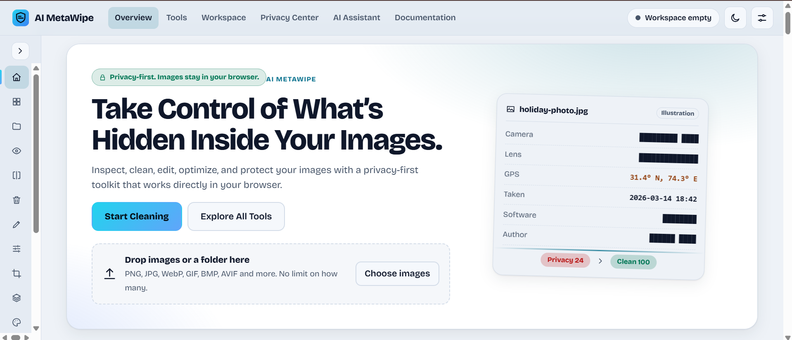</a>

</div>


---

## 📑 Table of contents

- [Overview](#-overview)
- [Screenshots](#-screenshots)
- [Features](#-features)
- [Quick start](#-quick-start)
- [How to use it](#-how-to-use-it)
- [AI Agent setup](#-ai-agent-setup)
- [Privacy and data flow](#-privacy-and-data-flow)
- [Supported formats](#-supported-formats)
- [Tech stack](#-tech-stack)
- [Project structure](#-project-structure)
- [Deployment](#-deployment)
- [Troubleshooting](#-troubleshooting)
- [Known limits](#-known-limits)
- [FAQ](#-faq)
- [Contributing](#-contributing)
- [License](#-license)

---

## ✨ Overview

Images carry more than pixels. A single photo can include the camera and lens, the exact GPS position where it was taken, capture dates, author names, an embedded thumbnail, and for AI-generated images the full prompt and workflow. **AI MetaWipe** shows you all of it, then lets you remove, edit or verify it before you share the picture.

- 🔍 **See everything.** EXIF, GPS, IPTC, XMP, PNG text chunks, C2PA content credentials and the raw file structure.
- 🧹 **Remove exactly what you choose.** One image or a whole folder, with the pixels left untouched.
- ✍️ **Write your own metadata.** Title, author, copyright, keywords, custom fields and reusable templates.
- 🛡️ **Prove it worked.** The Privacy Center re-reads the cleaned file and checks the result.
- 🎨 **Optimize while you are there.** Compress, convert, resize, crop, make backgrounds transparent, extract colours and find duplicates.
- 🤖 **Ask the AI agent.** Plain-language explanations and suggested clean-ups that only run when you approve them.
- 🔒 **Local first.** No server receives your images. Only the optional AI Agent contacts an outside service, and it never receives pixels.

---

## 🖼️ Screenshots

All screenshots were captured from the running application (version 3.0.0).

### 🏠 Dashboard

The Overview page has 19 sections, with a footer on every page. Numbers such as loaded images, GPS counts and privacy scores come from your actual workspace.


<table>
<tr>
<td width="50%" valign="top">

<a href="assets/screenshots/dashboard-quick-actions-light.png">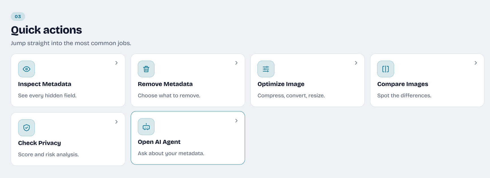</a><br><sub><b>Quick actions</b><br>Jump straight into inspecting, cleaning, optimizing, comparing, privacy checks and the AI agent.</sub>

</td>
<td width="50%" valign="top">

<a href="assets/screenshots/dashboard-recent-files-empty-light.png">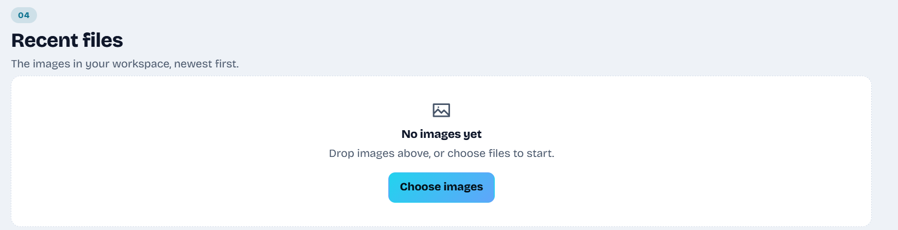</a><br><sub><b>Recent files</b><br>Your workspace gallery, with a clear empty state before any image is loaded.</sub>

</td>
</tr>
<tr>
<td width="50%" valign="top">

<a href="assets/screenshots/dashboard-tools-at-a-glance-light.png">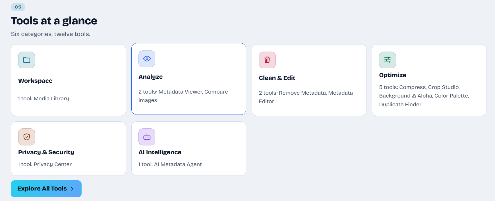</a><br><sub><b>Tools at a glance</b><br>Six categories and twelve tools in one view.</sub>

</td>
<td width="50%" valign="top">

<a href="assets/screenshots/dashboard-tools-directory-light.png">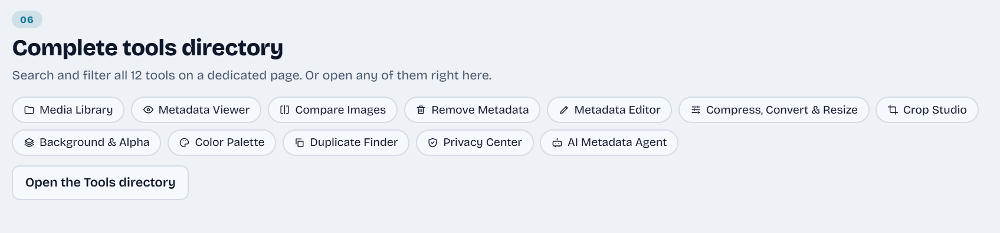</a><br><sub><b>Tools directory shortcuts</b><br>Open any of the 12 tools directly from the dashboard.</sub>

</td>
</tr>
<tr>
<td width="50%" valign="top">

<a href="assets/screenshots/dashboard-how-it-works-light.png">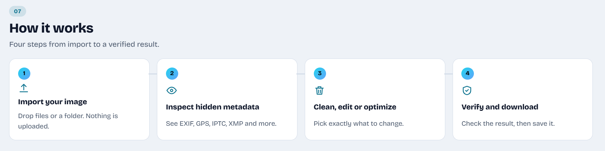</a><br><sub><b>How it works</b><br>Import, inspect, clean or edit, then verify and download.</sub>

</td>
<td width="50%" valign="top">

<a href="assets/screenshots/dashboard-metadata-intelligence-light.png">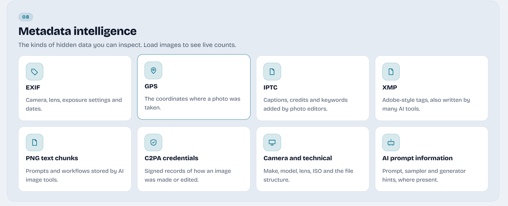</a><br><sub><b>Metadata intelligence</b><br>EXIF, GPS, IPTC, XMP, PNG text, C2PA, camera data and AI prompt information.</sub>

</td>
</tr>
<tr>
<td width="50%" valign="top">

<a href="assets/screenshots/dashboard-clean-and-protect-light.png">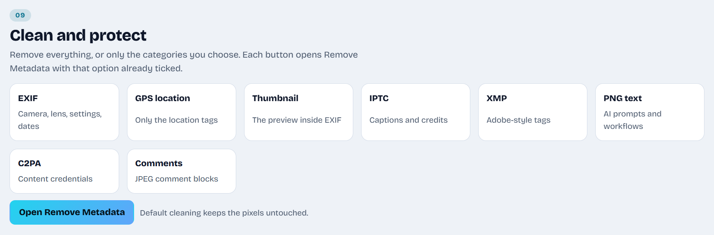</a><br><sub><b>Clean and protect</b><br>Each category opens Remove Metadata with that option already selected.</sub>

</td>
<td width="50%" valign="top">

<a href="assets/screenshots/dashboard-optimization-studio-light.png">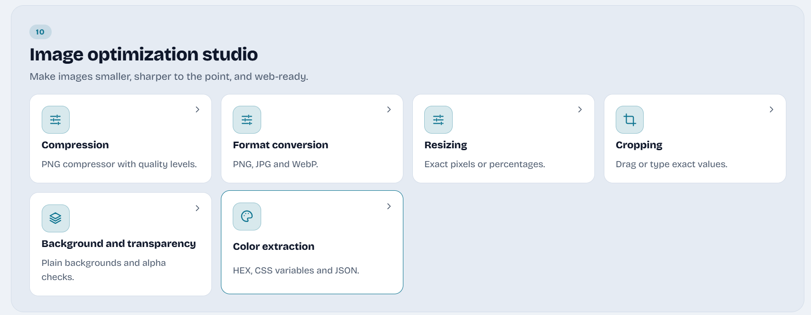</a><br><sub><b>Image optimization studio</b><br>Compression, conversion, resizing, cropping, transparency and colour extraction.</sub>

</td>
</tr>
<tr>
<td width="50%" valign="top">

<a href="assets/screenshots/dashboard-batch-processing-light.png">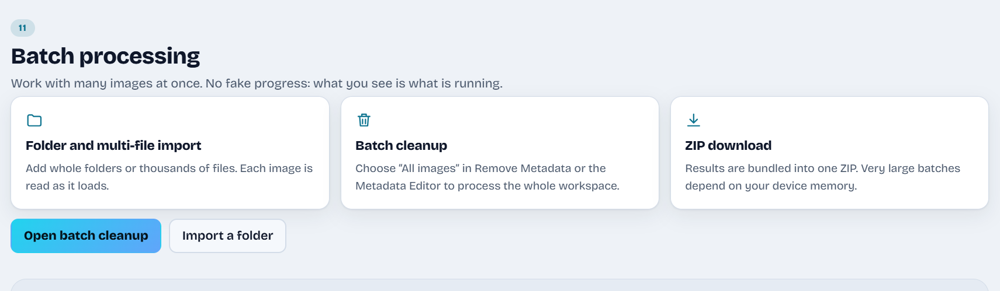</a><br><sub><b>Batch processing</b><br>Folder import, batch cleanup and ZIP downloads.</sub>

</td>
<td width="50%" valign="top">

<a href="assets/screenshots/dashboard-privacy-center-empty-light.png">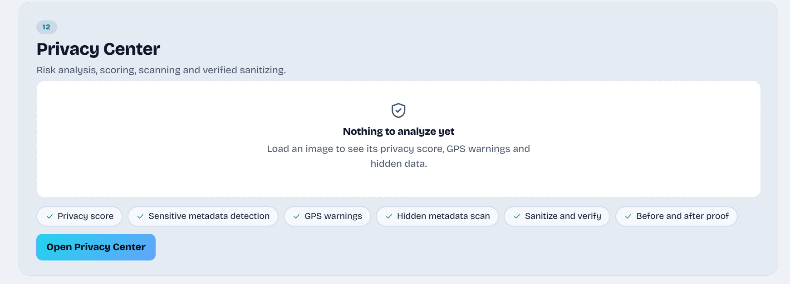</a><br><sub><b>Privacy Center section</b><br>Shows scores, GPS warnings and risks once images are loaded.</sub>

</td>
</tr>
<tr>
<td width="50%" valign="top">

<a href="assets/screenshots/dashboard-before-after-illustration-light.png">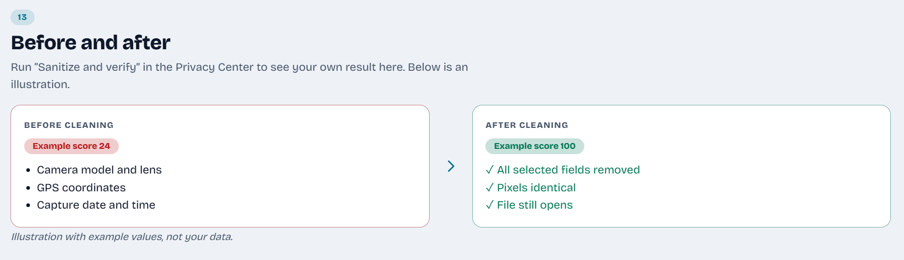</a><br><sub><b>Before and after</b><br>Labelled illustration. After you run "Sanitize and verify", your own result appears here.</sub>

</td>
<td width="50%" valign="top">

<a href="assets/screenshots/dashboard-ai-agent-light.png">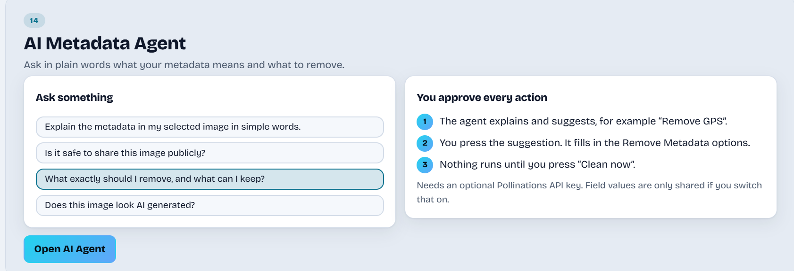</a><br><sub><b>AI Metadata Agent</b><br>Example questions and the approve-before-apply workflow.</sub>

</td>
</tr>
<tr>
<td width="50%" valign="top">

<a href="assets/screenshots/dashboard-privacy-architecture-light.png">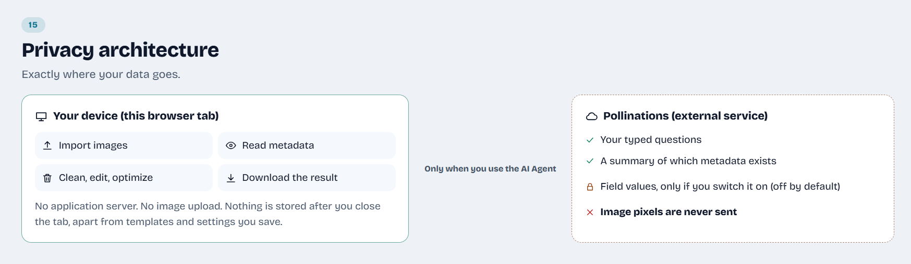</a><br><sub><b>Privacy architecture</b><br>Exactly what stays on your device and what the AI Agent sends.</sub>

</td>
<td width="50%" valign="top">

<a href="assets/screenshots/dashboard-supported-formats-light.png">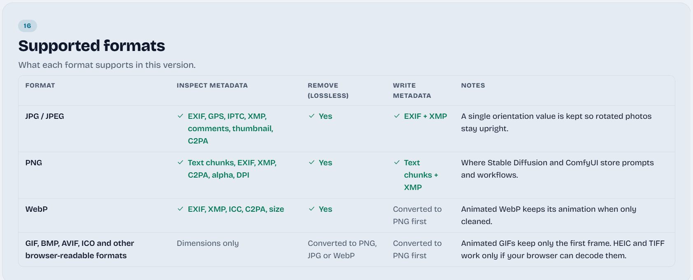</a><br><sub><b>Supported formats</b><br>What each format supports for inspecting, removing and writing.</sub>

</td>
</tr>
<tr>
<td width="50%" valign="top">

<a href="assets/screenshots/dashboard-use-cases-light.png">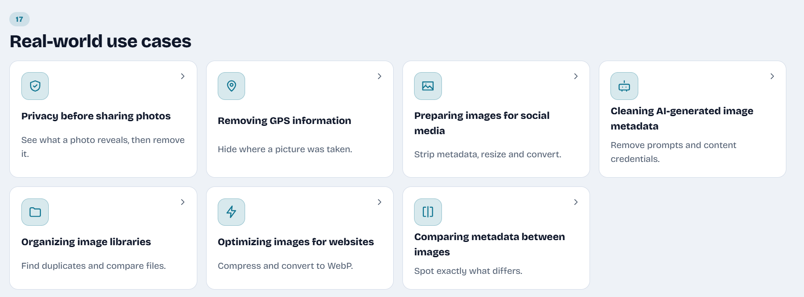</a><br><sub><b>Real-world use cases</b><br>Share safely, remove GPS, prepare for social media, clean AI images and more.</sub>

</td>
<td width="50%" valign="top">

<a href="assets/screenshots/dashboard-getting-started-light.png">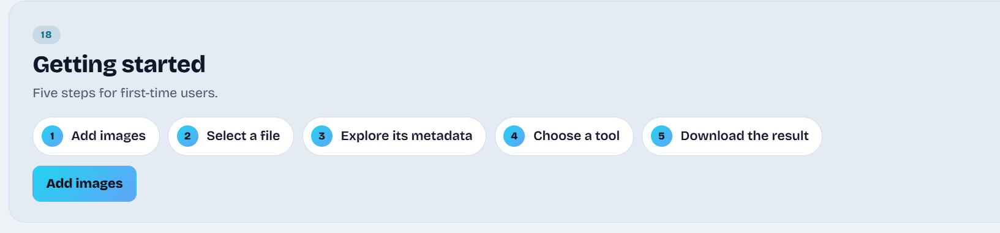</a><br><sub><b>Getting started</b><br>Five steps for first-time users.</sub>

</td>
</tr>
</table>


### 🧰 Tools directory and themes

Search and filter all 12 tools. AI MetaWipe ships with a dark theme (default) and a light theme, and can follow your device setting.


<p align="center">
<a href="assets/screenshots/tools-directory-dark.jpg">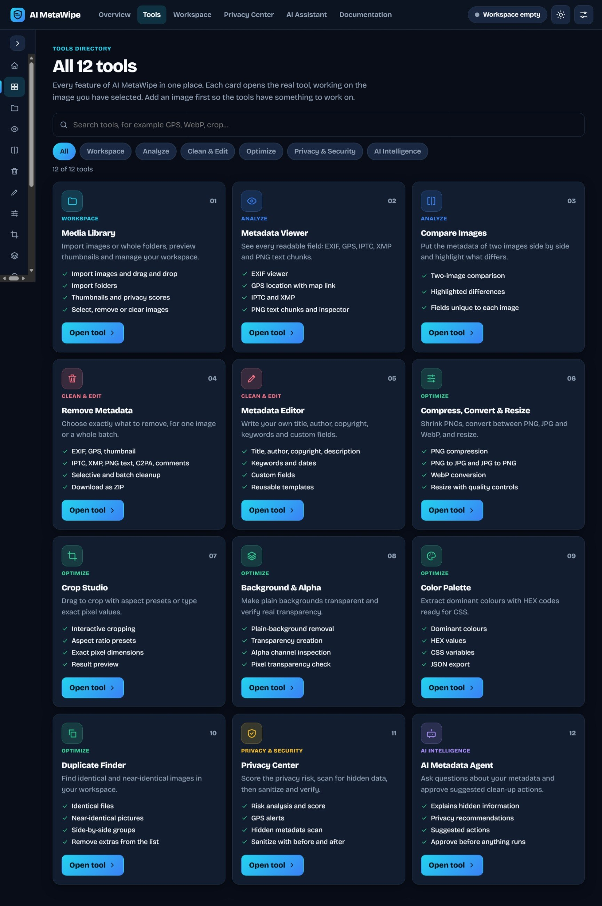</a><br>
<sub><i>Tools directory (dark theme) with search, category filters and an "Open tool" button on every card.</i></sub>
</p>


### 📚 Workspace

#### 01 · Media Library

Import images or whole folders, preview thumbnails, see privacy scores and manage your workspace.


<p align="center">
<a href="assets/screenshots/tool-media-library-light.png">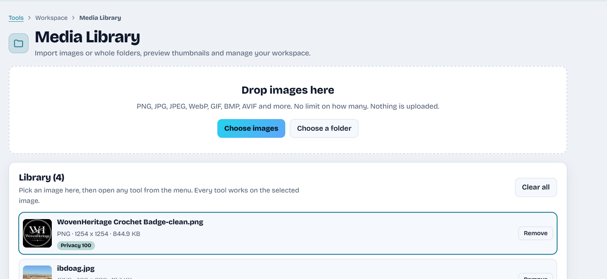</a><br>
<sub><i>Media Library: drag and drop, folder import, thumbnails and per-image privacy scores.</i></sub>
</p>


### 🔍 Analyze

#### 02 · Metadata Viewer

Properties, EXIF, GPS, IPTC and XMP, PNG text chunks and a technical inspector. Everything can be exported as TXT or JSON.


<p align="center">
<a href="assets/screenshots/tool-metadata-viewer-properties-light.png">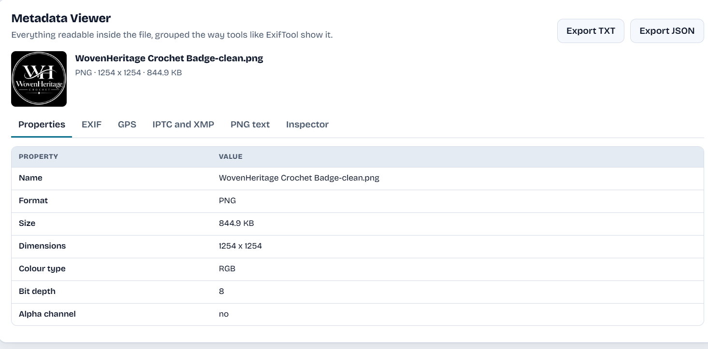</a><br>
<sub><i>Properties tab with format, size, dimensions, colour type and alpha channel.</i></sub>
</p>

<p align="center">
<a href="assets/screenshots/tool-metadata-viewer-iptc-xmp-light.png">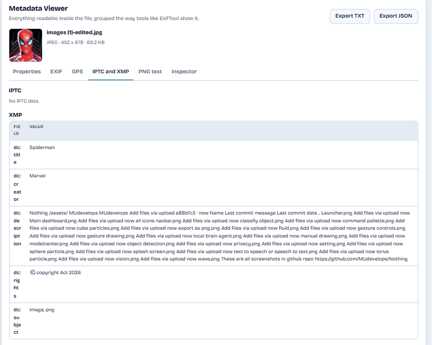</a><br>
<sub><i>IPTC and XMP tab listing the readable XMP fields stored in a file.</i></sub>
</p>

<p align="center">
<a href="assets/screenshots/tool-metadata-viewer-inspector-light.png">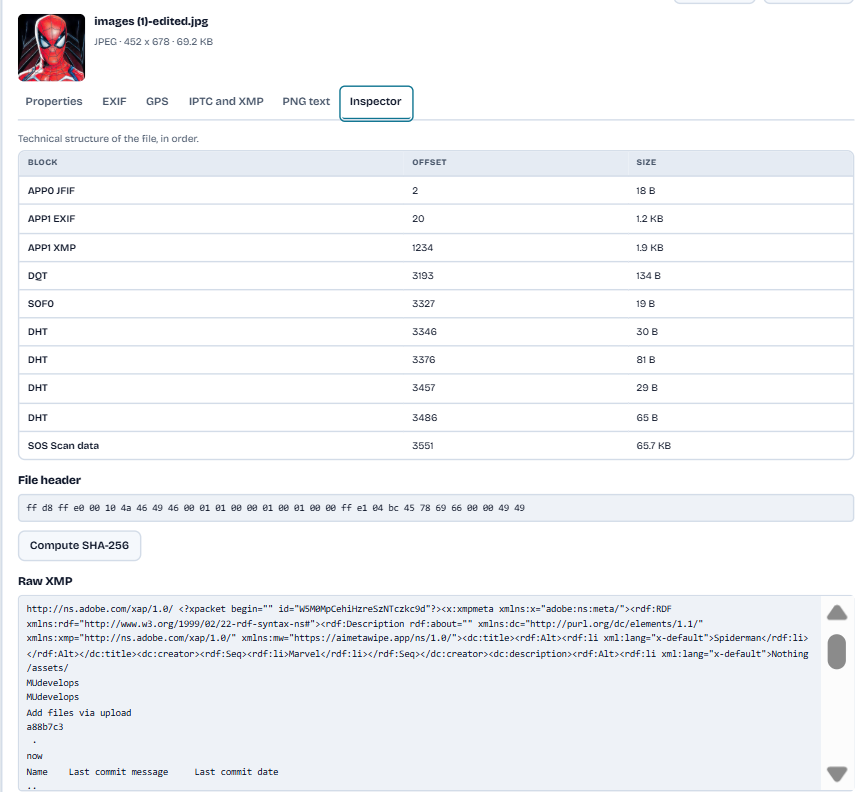</a><br>
<sub><i>Inspector tab showing the file structure block by block, with offsets and sizes.</i></sub>
</p>


#### 03 · Compare Images

Put two images side by side, highlight what differs and see which fields exist in only one of them.


<p align="center">
<a href="assets/screenshots/tool-compare-images-light.png">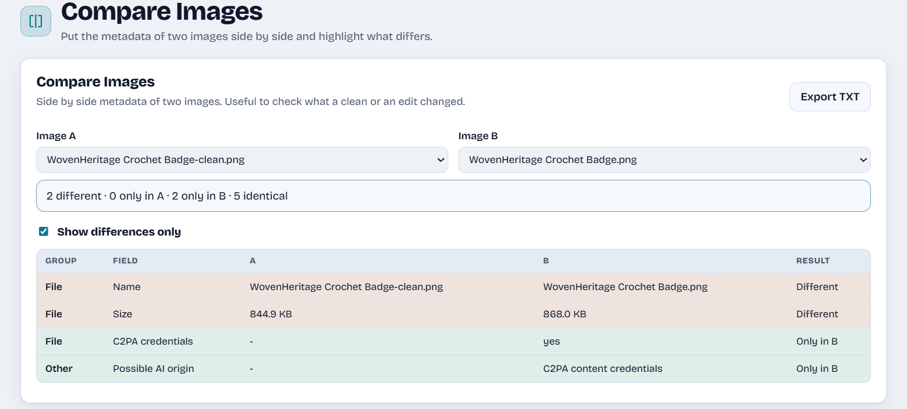</a><br>
<sub><i>Metadata comparison with highlighted differences and a "differences only" filter.</i></sub>
</p>


### 🧹 Clean and Edit

#### 04 · Remove Metadata

Choose exactly what to remove: EXIF, GPS only, thumbnail, IPTC, XMP, PNG text, C2PA, comments and more. Work on one image or the whole batch and download a ZIP. Pixels are never touched in the default method.


<p align="center">
<a href="assets/screenshots/tool-remove-metadata-light.png">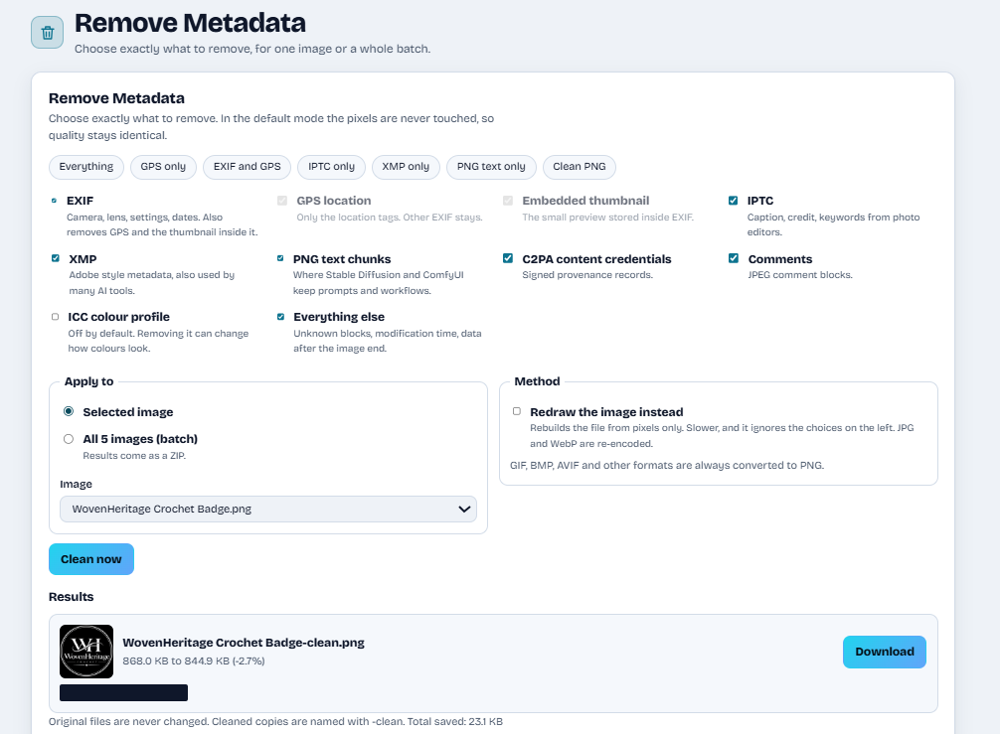</a><br>
<sub><i>Remove Metadata with presets such as "GPS only" and "Clean PNG", per-category options and batch scope.</i></sub>
</p>


#### 05 · Metadata Editor

Write title, author, copyright, description, keywords, a creation date and custom fields. Save the combination as a reusable template.


<p align="center">
<a href="assets/screenshots/tool-metadata-editor-dark.jpg">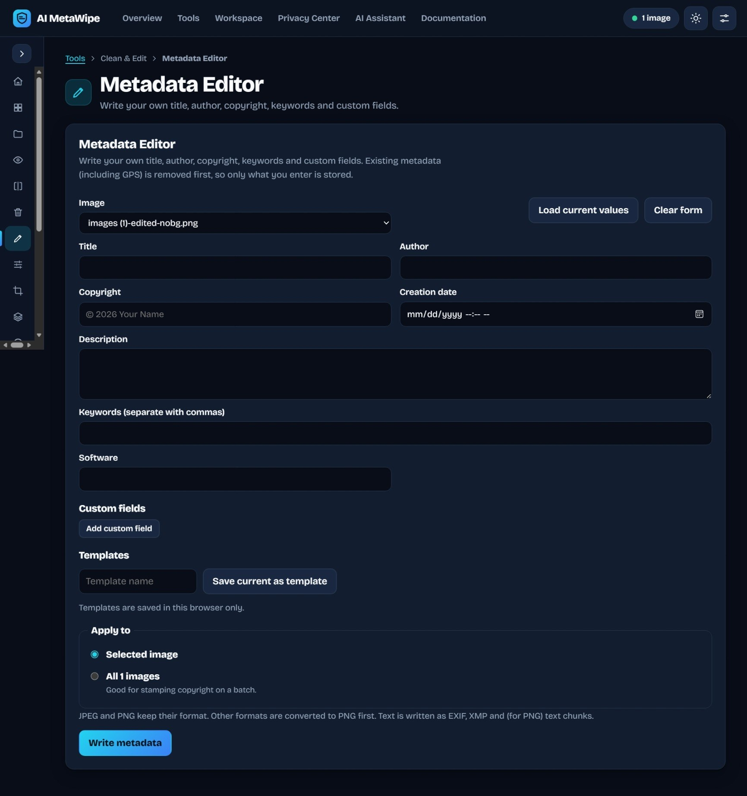</a><br>
<sub><i>Metadata Editor (dark theme) with templates, custom fields and batch scope.</i></sub>
</p>


### 🎨 Optimize

#### 06 · Compress, Convert and Resize

PNG compression with quality levels, PNG to JPG, JPG to PNG, WebP conversion and resizing. Every output file is free of metadata.


<p align="center">
<a href="assets/screenshots/tool-compress-png-dark.jpg">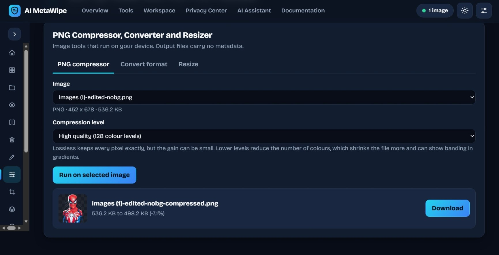</a><br>
<sub><i>PNG compressor with a before and after size.</i></sub>
</p>

<p align="center">
<a href="assets/screenshots/tool-convert-format-dark.jpg">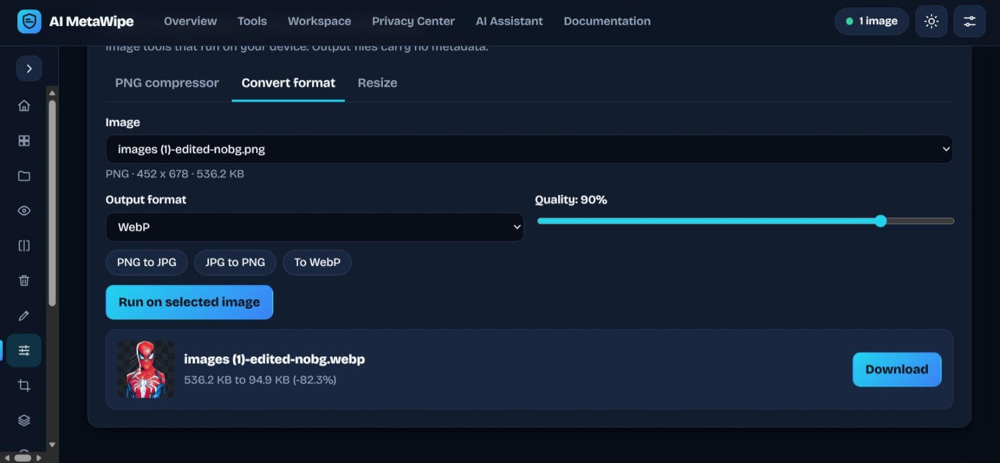</a><br>
<sub><i>Format converter with PNG to JPG, JPG to PNG and WebP presets.</i></sub>
</p>

<p align="center">
<a href="assets/screenshots/tool-resize-dark.jpg">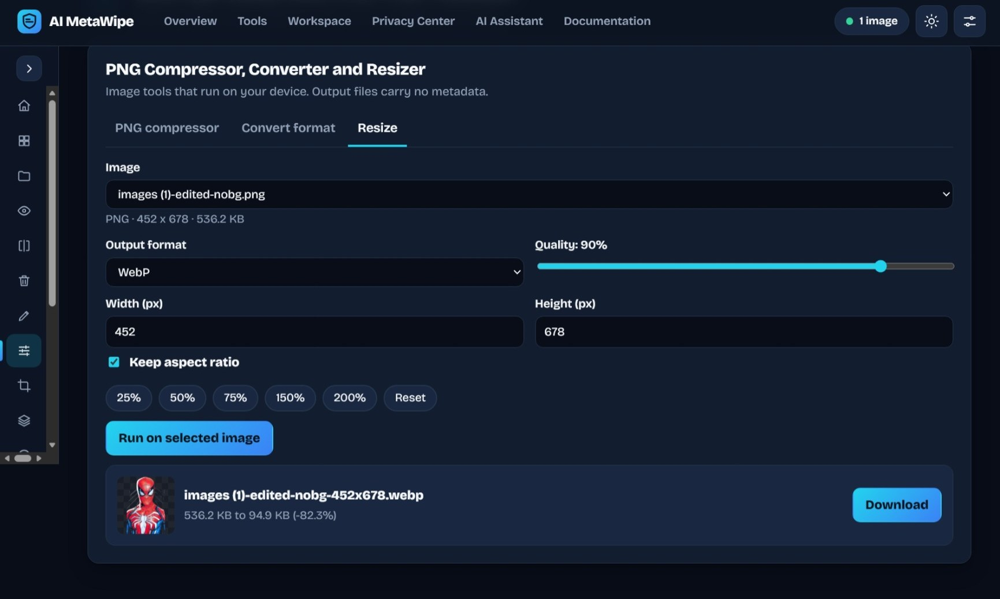</a><br>
<sub><i>Resizer with aspect ratio lock and percentage presets.</i></sub>
</p>


#### 07 · Crop Studio

Drag on the picture to select an area, use aspect presets or type exact pixel values.


<p align="center">
<a href="assets/screenshots/tool-crop-studio-dark.jpg">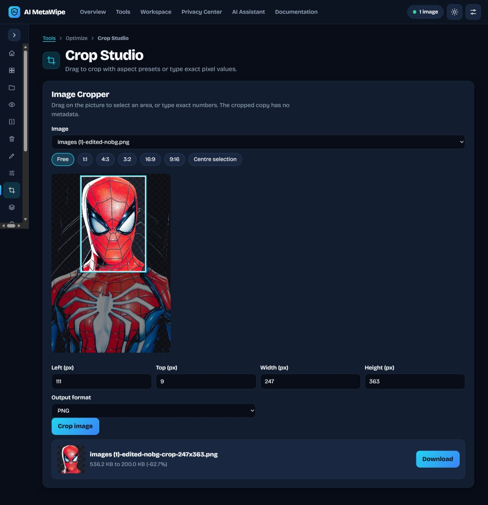</a><br>
<sub><i>Crop Studio with aspect ratio presets and a live selection.</i></sub>
</p>


#### 08 · Background and Alpha

Make a plain background transparent and verify real transparency pixel by pixel.


<p align="center">
<a href="assets/screenshots/tool-remove-background-dark.jpg">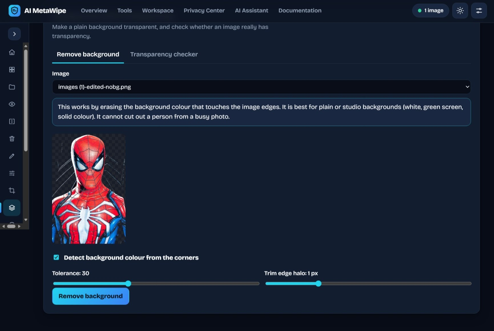</a><br>
<sub><i>Background removal for plain backgrounds, with tolerance and edge trimming.</i></sub>
</p>

<p align="center">
<a href="assets/screenshots/tool-transparency-checker-dark.jpg">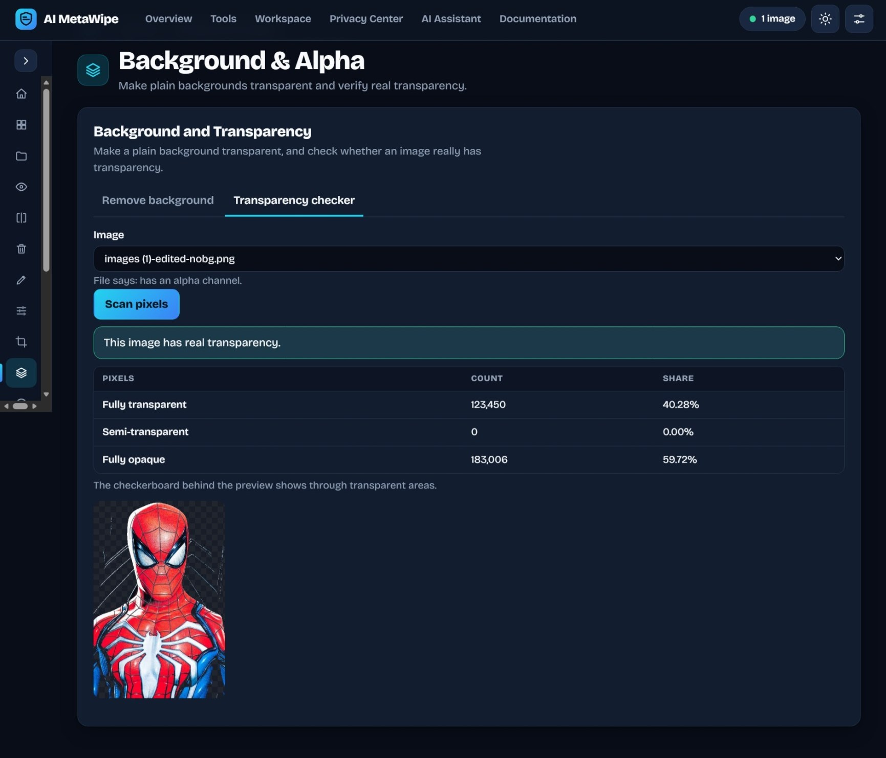</a><br>
<sub><i>Transparency checker with the count and share of transparent, semi-transparent and opaque pixels.</i></sub>
</p>


#### 09 · Color Palette

Extract the dominant colours with HEX values, then copy them as CSS variables or download a JSON palette.


<table>
<tr>
<td width="50%" valign="top">

<a href="assets/screenshots/tool-color-palette-light.png">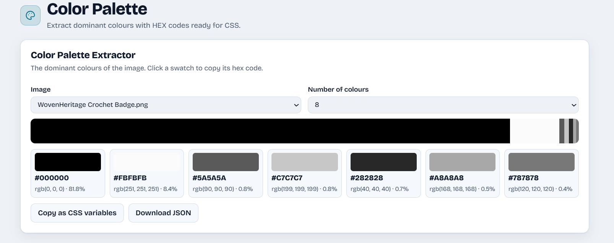</a><br><sub><b>Light theme</b><br>HEX values, RGB and the share of each colour.</sub>

</td>
<td width="50%" valign="top">

<a href="assets/screenshots/tool-color-palette-dark.jpg">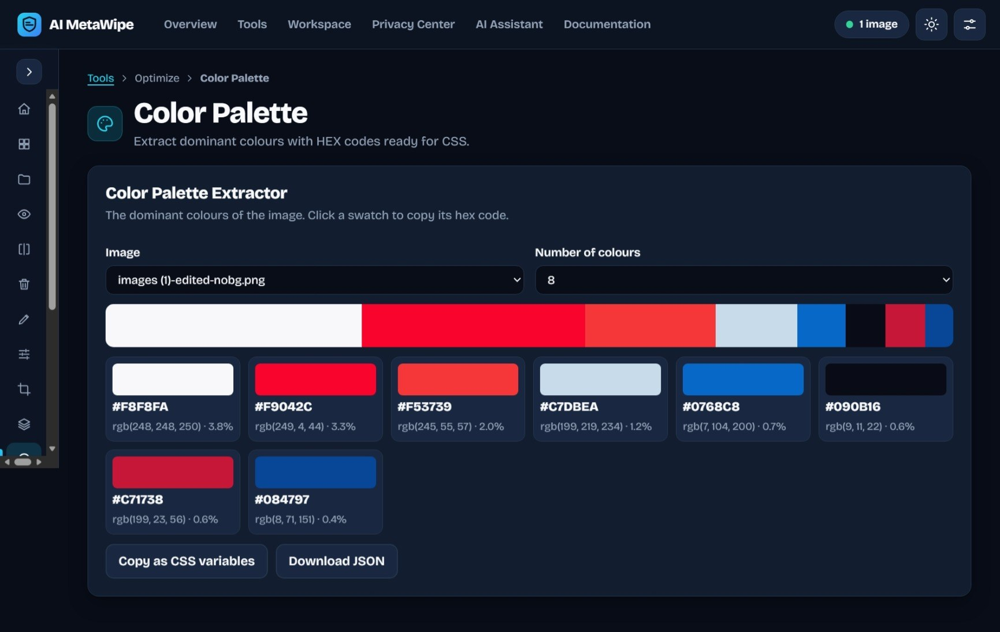</a><br><sub><b>Dark theme</b><br>Copy as CSS variables or download JSON.</sub>

</td>
</tr>
</table>


#### 10 · Duplicate Finder

Finds identical files and near-identical pictures, shows them side by side and lets you take the extras out of the workspace list.


<p align="center">
<a href="assets/screenshots/tool-duplicate-finder-light.png">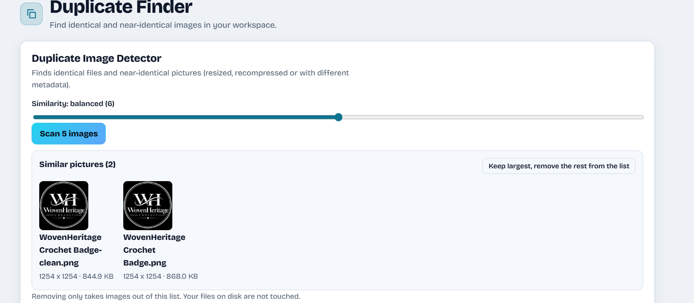</a><br>
<sub><i>Duplicate Finder with an adjustable similarity level and grouped results.</i></sub>
</p>


### 🛡️ Privacy and Security

#### 11 · Privacy Center

Risk analysis, an estimated privacy score, GPS alerts, a hidden data scan, a thumbnail scan and a "Sanitize and verify" action with before and after proof, a pixel comparison and an integrity checklist.


<table>
<tr>
<td width="50%" valign="top">

<a href="assets/screenshots/dashboard-privacy-center-empty-light.png"></a><br><sub><b>Overview section</b><br>The dashboard summary before any image is loaded.</sub>

</td>
<td width="50%" valign="top">

<a href="assets/screenshots/dashboard-before-after-illustration-light.png"></a><br><sub><b>Before and after</b><br>Illustration with example values. Your own result replaces it after you verify a clean.</sub>

</td>
</tr>
</table>


### 🤖 AI Intelligence

#### 12 · AI Metadata Agent

Ask questions about the images you loaded, understand what hidden information means, get privacy advice and receive suggested clean-up actions. **Nothing runs until you approve it.**


<p align="center">
<a href="assets/screenshots/tool-ai-agent-answer-light.png">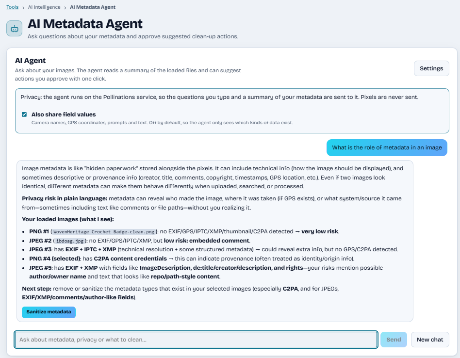</a><br>
<sub><i>The agent explains metadata in plain language and lists risks for the loaded images.</i></sub>
</p>

<p align="center">
<a href="assets/screenshots/tool-ai-agent-analysis-light.png">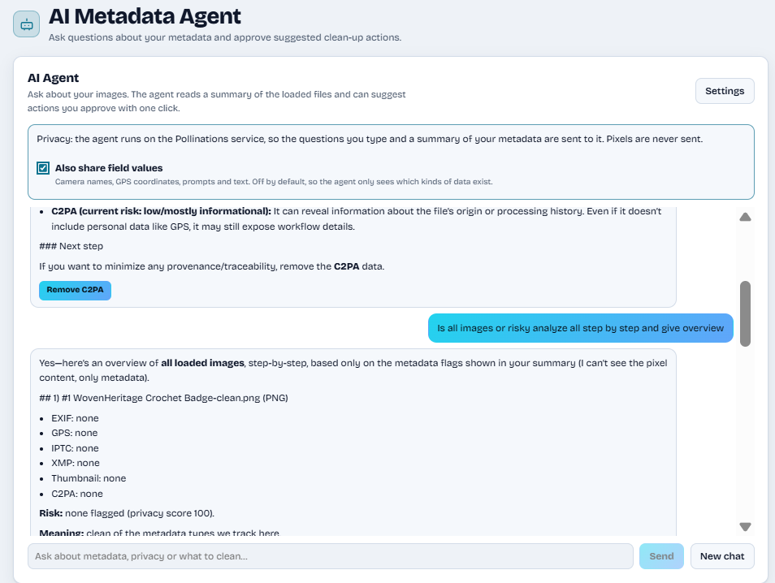</a><br>
<sub><i>A step-by-step analysis with a suggested action button such as "Remove C2PA".</i></sub>
</p>

<p align="center">
<a href="assets/screenshots/tool-ai-agent-thinking-light.png">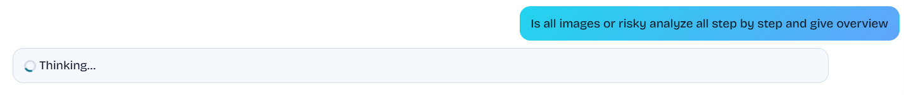</a><br>
<sub><i>Live "Thinking…" indicator while the answer is generated.</i></sub>
</p>


### 🧭 Workflows, documentation and settings


<p align="center">
<a href="assets/screenshots/page-workflows-light.png">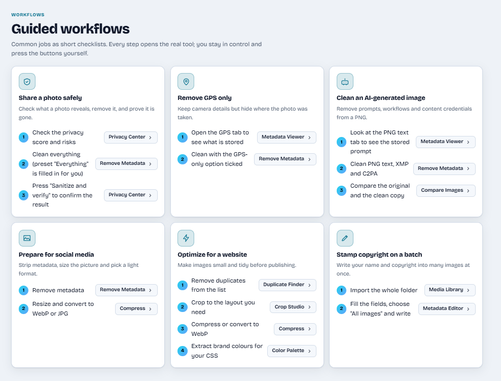</a><br>
<sub><i>Guided workflows: common jobs as checklists that open the real tools.</i></sub>
</p>

<p align="center">
<a href="assets/screenshots/page-documentation-light.png">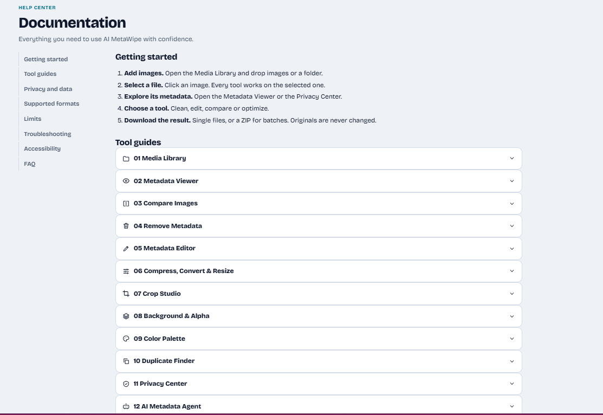</a><br>
<sub><i>Built-in documentation with tool guides, privacy diagram, formats, limits and FAQ.</i></sub>
</p>

<p align="center">
<a href="assets/screenshots/dialog-settings-light.png">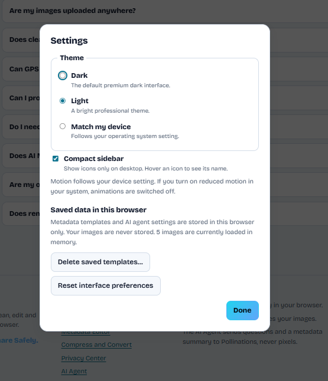</a><br>
<sub><i>Settings: dark, light or match-my-device theme, and a compact sidebar option.</i></sub>
</p>


<details>
<summary><b>More screenshots</b></summary>

<br>


<p align="center">
<a href="assets/screenshots/tool-metadata-viewer-properties-alt-light.png">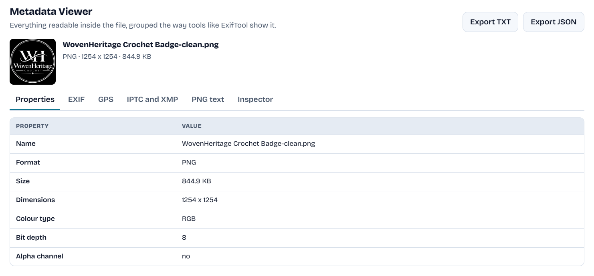</a><br>
<sub><i>Metadata Viewer, properties tab (second capture).</i></sub>
</p>

<p align="center">
<a href="assets/screenshots/tool-remove-metadata-options-light.png">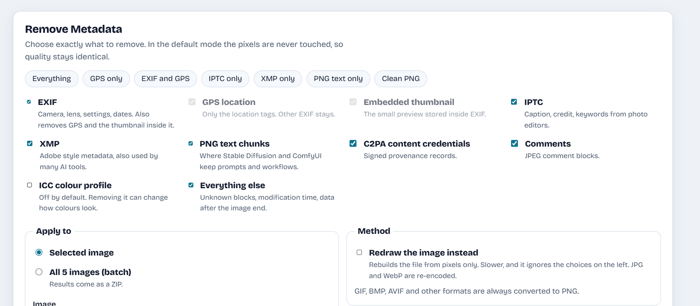</a><br>
<sub><i>Remove Metadata: full list of options, apply-to scope and cleaning method.</i></sub>
</p>


</details>


---

## 🚀 Features

| # | Tool | What it does |
| :-: | --- | --- |
| 01 | **Media Library** | Import images or folders, thumbnails, privacy scores, select, remove or clear. |
| 02 | **Metadata Viewer** | EXIF, GPS with map link, IPTC, XMP, PNG text chunks, inspector, TXT and JSON export. |
| 03 | **Compare Images** | Side-by-side metadata with highlighted differences. |
| 04 | **Remove Metadata** | Selective and batch removal of EXIF, GPS, thumbnail, IPTC, XMP, PNG text, C2PA and comments, with ZIP download. |
| 05 | **Metadata Editor** | Title, author, copyright, description, keywords, dates, custom fields and templates. |
| 06 | **Compress, Convert and Resize** | PNG compression, PNG to JPG, JPG to PNG, WebP conversion and resizing with quality controls. |
| 07 | **Crop Studio** | Interactive crop with aspect presets and exact pixel values. |
| 08 | **Background and Alpha** | Plain-background removal and pixel-level transparency check. |
| 09 | **Color Palette** | Dominant colours, HEX, CSS variables and JSON export. |
| 10 | **Duplicate Finder** | Identical and near-identical image detection. |
| 11 | **Privacy Center** | Risk analysis, privacy score, GPS alerts, hidden data scan, sanitize and verify, integrity check. |
| 12 | **AI Metadata Agent** | Explains metadata and suggests clean-up actions you approve first. |

**Interface:** top bar, collapsible sidebar, tools directory with search and filters, guided workflows, help center, toast messages, confirmation dialogs, real progress bars, keyboard accessibility and reduced-motion support.

---

## ⚡ Quick start

**Requirements:** [Node.js](https://nodejs.org) 18 or newer.

```bash
# 1. clone the repository
git clone https://github.com/MUdevelops/AI-MetaWipe.git
cd AI-MetaWipe

# 2. install dependencies
npm install

# 3. start the development server
npm run dev
```

Open the address shown in the terminal, usually `http://localhost:5173`.

| Command | Purpose |
| --- | --- |
| `npm run dev` | Start the development server |
| `npm run build` | Create a production build in `dist/` |
| `npm run preview` | Preview the production build locally |

---

## 🧭 How to use it

1. **Add images.** Drop images or a folder on the Overview page, or open the **Media Library**.
2. **Select a file.** Click an image. Every tool works on the selected image.
3. **Explore its metadata.** Open the **Metadata Viewer**, or the **Privacy Center** for a score and a risk list.
4. **Choose a tool.** Clean, edit, compare or optimize.
5. **Download the result.** Single files, or a ZIP for batches. Your originals are never changed, and results are named with `-clean`, `-edited` or a similar suffix.

**Verify a clean.** Open the **Privacy Center** and press **Sanitize and verify**. It re-reads the new file and shows the privacy score before and after, whether the pixels are identical, and whether each removed category is really gone.

---

## 🤖 AI Agent setup

The agent is optional. Every other tool works without it and without any key. It uses the **Pollinations** OpenAI-compatible chat endpoint.

1. Create an account and API key at [enter.pollinations.ai](https://enter.pollinations.ai).
2. Open **AI Agent** and press **Settings**.
3. Paste your key. The default model is `openai` and the default endpoint is `https://gen.pollinations.ai/v1/chat/completions`.
4. Ask a question or press one of the quick prompts.

**Approve before apply.** When the agent recommends cleaning, it shows buttons such as **Remove GPS**. Pressing one opens **Remove Metadata** with those options already ticked. Nothing runs until you press **Clean now**.

> The key is stored only in your browser. Anything stored by a browser app can be inspected, so use a key you can revoke.

---

## 🔒 Privacy and data flow

| Feature | Leaves your device? |
| --- | --- |
| Viewer, removal, editor, optimize, crop, background, palette, duplicates, Privacy Center | ❌ Never. Everything is processed locally in your browser. |
| AI Agent | ⚠️ Your typed questions and a **summary** of which metadata exists are sent to Pollinations. **Image pixels are never sent.** |
| AI Agent, "Also share field values" | Off by default. When enabled, camera names, coordinates, prompts and text values are included as well. |
| Web font (Bricolage Grotesque) | Loaded from Google Fonts when online. A system font is used offline. |

There is no application backend. Nothing is stored after you close the tab, apart from templates, theme and agent settings that you save in your own browser.

---

## 🗂️ Supported formats

| Format | Inspect metadata | Remove (lossless) | Write metadata | Notes |
| --- | --- | --- | --- | --- |
| **JPG / JPEG** | EXIF, GPS, IPTC, XMP, comments, thumbnail, C2PA | ✅ | ✅ EXIF + XMP | A single orientation value is kept so rotated photos stay upright. |
| **PNG** | Text chunks, EXIF, XMP, C2PA, alpha, DPI | ✅ | ✅ Text chunks + XMP | Where Stable Diffusion and ComfyUI store prompts and workflows. |
| **WebP** | EXIF, XMP, ICC, C2PA, size | ✅ | Converted to PNG first | Animated WebP keeps its animation when only cleaned. |
| **GIF, BMP, AVIF, ICO and other browser-readable formats** | Dimensions only | Converted to PNG, JPG or WebP | Converted to PNG first | Animated GIFs keep only the first frame. HEIC and TIFF work only if your browser can decode them. |

---

## 🧱 Tech stack

- **React 18** and **JSX**
- **Vite 5**
- Plain **CSS** with design tokens (dark and light themes)
- Browser APIs for everything else: Canvas, `createImageBitmap`, `DecompressionStream`, `crypto.subtle`

Only `react` and `react-dom` are used at runtime. The metadata parser, metadata writer and ZIP creator are written from scratch.

---

## 📁 Project structure

```text
AI-MetaWipe
├── assets/
│   ├── logo.svg
│   └── screenshots/            README images
├── index.html
├── package.json
├── vite.config.js
└── src
    ├── main.jsx · App.jsx · styles.css · shell.css
    ├── components
    │   ├── shell/              Topbar · Sidebar · Footer · SettingsModal
    │   ├── pages/              Overview · ToolsDirectory · Workflows · Help
    │   ├── Library · Viewer · Compare · Remover · Editor
    │   ├── Optimize · Crop · Background · Palette · Duplicates
    │   ├── Privacy · Agent
    │   └── Icon · Toast · Confirm · ui
    └── lib
        ├── tools.js            registry of the 12 tools
        ├── meta.js             reads JPEG / PNG / WebP metadata
        ├── edit.js             selective removal and metadata writer
        ├── strip.js            quick cleaner and format detection
        ├── privacy.js          risk analyzer and privacy score
        ├── imgtools.js         canvas tools, hashes, palette
        ├── agent.js            Pollinations client and action parser
        ├── report.js           TXT / JSON export and comparison
        ├── pipeline.js         clean pipeline
        └── zip.js              small ZIP writer
```

---

## 🌍 Deployment

```bash
npm run build
```

This creates a static `dist/` folder that any static host can serve.

- **Netlify:** drag `dist` onto [app.netlify.com/drop](https://app.netlify.com/drop).
- **Vercel:** run `npx vercel` and accept the defaults.
- **GitHub Pages:** set `base: '/AI-MetaWipe/'` in `vite.config.js`, rebuild and publish `dist`.

---

## 🛠️ Troubleshooting

| Problem | Fix |
| --- | --- |
| `npm` is not recognized | Install Node.js 18 or newer, then reopen the terminal. |
| `npm install` fails | Delete `node_modules` and run it again. |
| Agent says it was rejected | Add a valid Pollinations API key in the agent's Settings. |
| Agent says it could not reach the service | Check your internet connection and the endpoint in Settings. |
| A photo looks rotated after cleaning | Use the default method, which keeps the orientation value. |
| HEIC or TIFF is not supported | Your browser cannot decode it. Safari handles HEIC. |
| Background removal cuts into the subject | Lower the tolerance. It is built for plain backgrounds. |
| Images in this README do not show | Make sure the `assets/` folder was pushed together with `README.md`. |

---

## ⚠️ Known limits

- **Metadata only.** Invisible watermarks written into the pixels (for example SynthID) are not metadata and are not removed.
- **Editing replaces existing metadata.** Writing new fields removes the old ones first, including GPS.
- **Background removal** erases a colour connected to the image edges. It is not an AI cut-out tool.
- **Compression below "Lossless"** reduces colours, which can band smooth gradients.
- **Animated GIFs** keep only the first frame when converted.
- **Very large batches** depend on your device memory.
- The **privacy score** is an estimate, not a guarantee.

---

## ❓ FAQ

<details>
<summary><b>Are my images uploaded anywhere?</b></summary>
<br>
No. Reading, cleaning, editing, optimizing and checking all run inside your browser. Only the optional AI Agent contacts an outside service, and it receives text, never pixels.
</details>

<details>
<summary><b>Does cleaning reduce image quality?</b></summary>
<br>
Not with the default method for JPG, PNG and WebP. The metadata blocks are removed and the image data is copied unchanged. Redraw mode, format conversion, compression below lossless, resizing and cropping do re-encode the image.
</details>

<details>
<summary><b>Can GPS information be removed?</b></summary>
<br>
Yes. Use the "GPS only" preset in Remove Metadata or sanitize from the Privacy Center. GPS values copied into XMP are removed as well.
</details>

<details>
<summary><b>Can I process multiple images at once?</b></summary>
<br>
Yes. Add as many images or folders as you like, choose "All images" and download the results as a ZIP.
</details>

<details>
<summary><b>Do I need the AI Agent?</b></summary>
<br>
No. Every other tool works without it and without an API key.
</details>

<details>
<summary><b>Does it work offline?</b></summary>
<br>
Yes, once the page has loaded. The AI Agent needs an internet connection.
</details>

<details>
<summary><b>Are my original files modified?</b></summary>
<br>
No. Every result is a new download with a suffix such as <code>-clean</code> or <code>-edited</code>.
</details>

<details>
<summary><b>Does removing metadata remove invisible watermarks?</b></summary>
<br>
No. Watermarks such as SynthID live in the pixels, not in metadata.
</details>

---

## 🤝 Contributing

Issues and pull requests are welcome at [github.com/MUdevelops/AI-MetaWipe](https://github.com/MUdevelops/AI-MetaWipe/issues). Please keep changes local-first: no backend, no uploading of user images, and no fake statistics or placeholder features.

## 📄 License

See the `LICENSE` file in the repository root.

---

<div align="center">

### 🧼 AI MetaWipe

**View. Clean. Edit. Optimize. Share Safely.**

</div>
